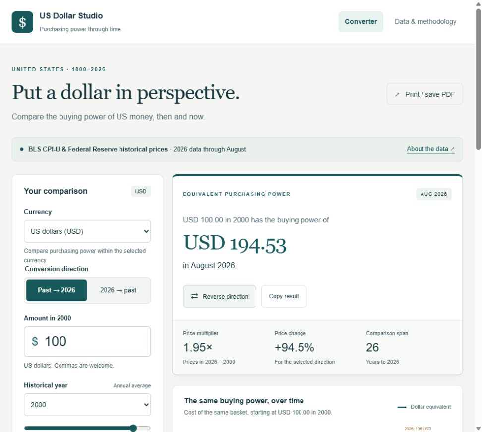

# Australian Dollar Studio

An accessible, offline-capable Australian purchasing-power converter styled to match Commodity Security Studio.

The **Currency** selector also supports **US dollars (USD)** with the same conversion directions, chart, reference-period choices, copy, CSV export and print/PDF features. Australian dollars remain the default, and the Australian dataset and pre-decimal pound option are retained. Comparisons take place within the selected currency; the selector does not apply an exchange rate.

## Open the app

Double-click **dist/Australian Dollar Studio.html**. This single file contains the entire app and the verified CPI snapshot. No installation, account, server or API key is needed. It can be copied to another computer or served by a static website host.

For local development, install **Node.js 22 or newer**, run `npm run dev`, and open **http://127.0.0.1:4173/**. There are no JavaScript dependencies to install.

## Data and interpretation

### US dollar option

- **1800–1912:** historical estimates from the Federal Reserve Bank of Minneapolis. The earliest series reflects Vermont family-living prices, followed by Hoover's and Rees's price series. Early values have different population coverage and are labelled estimates.
- **1913–2025:** calendar-year arithmetic averages of monthly, non-seasonally-adjusted BLS CPI-U all-items, US city average observations, series **CUUR0000SA0**. The 2025 average follows the BLS exception: **11 published months**, because October's index was unavailable due to the federal funding lapse. No missing month is invented.
- **2026:** August CPI-U **334.980**, or the January–August average. The BLS release date is **11 September 2026**, checked **10 October 2026**.

The historical series is linked at 1913: historic index × (1913 monthly annual mean / historical 1913 index). This puts every US observation on the **1982–1984 = 100** scale. The Minneapolis Fed's estimated full-year 2026 value is excluded; both 2026 references use published BLS observations.

Raw sources are saved in `data/us-minneapolis-history.html`, `data/us-bls-history.json` and `data/us-bls-2025-2026.json`. The bundled dataset and provenance are in `data/us-cpi.json`. `scripts/build-us-data.py` rebuilds the snapshot from these files. `scripts/download-us-data.py` intentionally retrieves the historical API responses when updating the snapshot; current-year responses and release metadata must also be updated together. Normal app use makes no network requests.

### Australian dollar option

- **1850–1900**: Sydney retail price series from ABS Year Book Australia 2003, Table 28.4. Local historical proxy, not national CPI.
- **1901–1948**: linked retail price series from the same ABS table.
- **1949–2025**: arithmetic average of each calendar year's four all-groups Australian CPI observations, ABS Table 17, series A2325846C.
- **2026**: August CPI (103.50) or the January–August monthly average from ABS Table 1, series A130393720C. A full-year 2026 annual average is not yet available.

Both current ABS workbooks use the September 2025 reference scale. Historical values are linked at 1949: old historical index × (modern 1949 annual average / 128). Do not splice different reference scales without this adjustment. Source files are preserved in `data/`; all source links and the link factor are in `data/cpi.json`.

Converted value = amount × destination index / source index. Computations retain full precision and display two decimal places. Before 1966, AUD values are hypothetical dollar equivalents. Optional Australian-pound input/output uses £1 = A$2; fractions of pounds are entered as decimal amounts. CPI measures consumer prices, not asset prices or wages.

Snapshot checked **9 October 2026**, based on the ABS **30 September 2026** release. It does not update automatically. The page, copied results and CSV clearly identify the selected partial-year 2026 basis. To update, download matching dated ABS workbooks, update the metadata and validation in `scripts/build-data.py`, rebuild the JSON and standalone file, and run the tests. Never replace monthly CPI levels with percentage-change series.

## Accessibility and export

Native labelled inputs; keyboard-accessible radio controls; visible focus; screen-reader live results; a skip link; error messages associated with the amount field; reduced-motion support; responsive layout; chart text alternative and a complete data table. CSV includes source links and reference periods. Print / save PDF uses a dedicated print layout.

## Build and checks

`npm run build` rebuilds the portable app from the source and both CPI datasets. `npm test` runs nine checks covering continuous historical coverage, index linking, published 2026 periods, round trips, decimalisation, invalid inputs, the missing US October 2025 observation and the portable app bundle. GitHub Actions also runs these checks and verifies that the committed portable app matches its source.

The optional data rebuild requires Python with pandas, openpyxl and lxml: `python scripts/build-data.py` for Australia or `python scripts/build-us-data.py` for the US. Normal use and the portable build need no Python installation.
